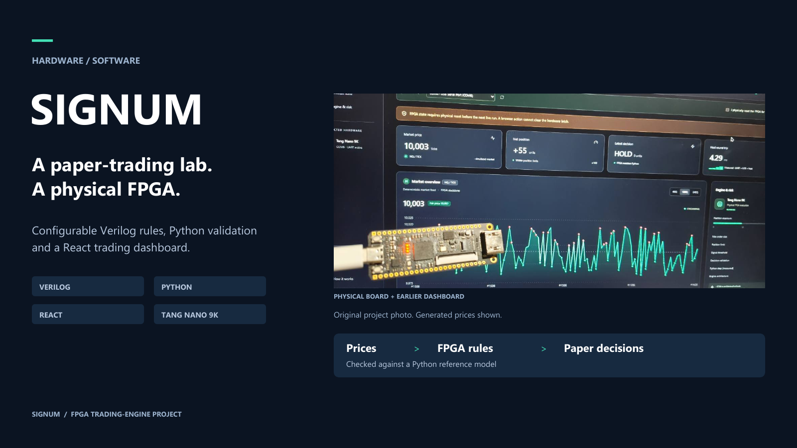
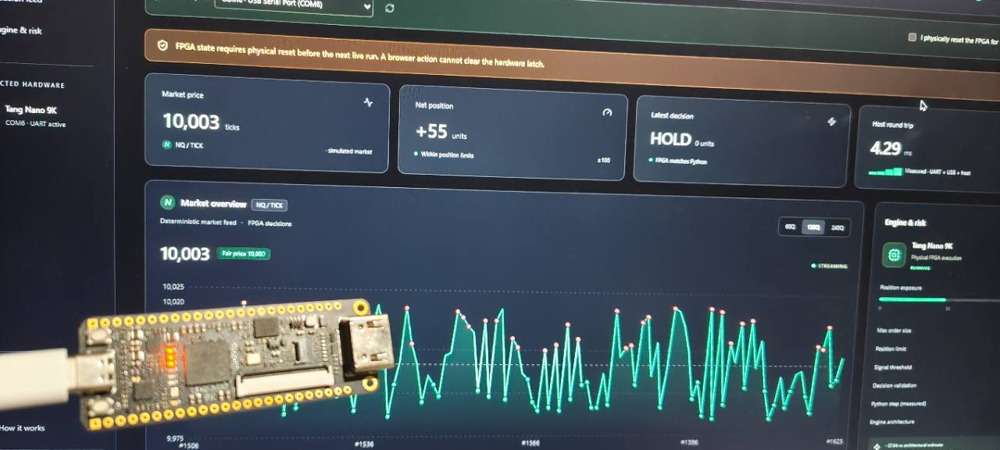
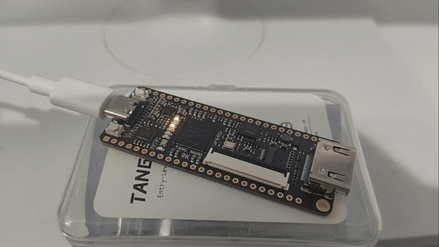
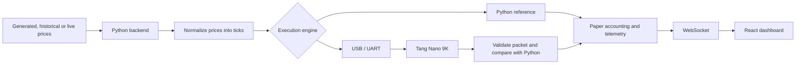

<div align="center">

# Signum

### A trading idea, a Python reference, a physical FPGA.

Explore paper trading with configurable Verilog rules, historical replay, and a live React dashboard.

[**Try the demo**](https://signum-aayan14.vercel.app/) · [Run locally](#run-locally) · [Hardware guide](docs/hardware.md) · [Research workflow](docs/research-workflows.md)



**Verilog** · **Python / FastAPI** · **React / TypeScript** · **Tang Nano 9K** · **Alpaca PAPER** · **Azure AI**

</div>

## What is Signum?

Signum is a trading research and hardware learning project. Start with a simple
rule, test it on prices, and follow its decisions through a simulated portfolio.
In the local app, the same inputs can run through a physical Tang Nano 9K FPGA,
with every reply checked against a Python reference model.

I built it to explore active trading through paper accounts while learning how
software and digital hardware communicate. The project brings together Verilog,
serial protocols, market data, backtesting, and an interface that makes the
results visible.

### Choose your experience

| | Public browser demo | Local workstation |
|---|---|---|
| Get started | Open the website | Run Python + React on your PC |
| Prices | AAPL, NVDA and MSFT daily closes from 2017, practice prices, CSV import | Generated prices, downloaded history, Alpaca IEX live data |
| Decision engine | Browser JavaScript | Python or physical FPGA |
| Portfolio | Independent $10,000 virtual portfolio | Local $10,000 or persistent Alpaca PAPER account |
| Strategy research | Edit rules, replay, separate-period tests, JSON export | Autosave, revision backups, frozen snapshots, saved experiments |
| AI assistant | — | Azure drafting with retrieved scholarly records |
| Hardware | — | USB/UART configuration, validation and telemetry |

All trading uses simulated funds. The public demo runs independently in each
visitor's browser. Physical hardware and account integrations belong to the local app.

## See it working



*Original project photo showing an earlier dashboard during a generated-price
hardware run. The current interface has evolved since this capture.*

<details>
<summary><strong>Watch the connected board</strong></summary>



*Excerpt from original project footage. The clip shows the physical board and LEDs.
Use validated dashboard telemetry to interpret trading decisions.*

</details>

## Follow a price through the system



The public demo runs its replay engine and portfolio directly in the browser.
The diagram describes the local workstation.

### What the strategy does

| Rule | Reference price | Decision |
|---|---|---|
| Fixed-anchor reversion | First price of the session | Buy below the reference by the threshold, sell above it |
| Moving-average reversion | Average of the previous N samples | Buy below the average by the threshold, sell above it |

Quotes inside the threshold produce HOLD. Moving-average rules wait for enough
samples to fill their window. Orders are clipped by the requested quantity,
maximum order size, and remaining position room.

Real USD prices are mapped into basis-point ticks around a fixed session anchor.
The threshold is expressed in those normalized ticks. The engine tracks signed
positions, while the cash-only portfolio and paper broker apply their own
cash/holdings constraints. An engine signal can therefore produce a smaller fill
or no fill.

The FPGA accepts configurable thresholds, order caps and position caps. Its SMA
windows are **2, 4, 8, 16, 32 and 64**. Settings upload before a run, are read back
for validation, and remain locked until physical reset. Other editor windows run
in Python. See [configuration and supported ranges](docs/fpga-configuration.md).

## Explore the research tools

- **Replay the market.** Adjust playback speed, inspect BUY/SELL markers, and
  follow cash, holdings, fees and profit/loss.
- **Keep your work.** Save declarative strategy JSON, recover drafts, restore
  revisions, and freeze a version before testing it.
- **Compare periods.** Develop on the first 70% of a dataset and evaluate the
  later 30% separately. Historical backtests include next-sample fills, fees and slippage.
- **Draft with AI.** Describe a hypothesis and review Azure's candidate settings
  alongside Crossref metadata and available abstract excerpts. Apply to editor,
  undo changes, or save and backtest the candidate in one action.
- **Observe live paper execution.** Select Alpaca PAPER explicitly to use its
  persistent virtual account and inspect simulated orders in Alpaca.
- **Inspect the engineering.** View UART validation, communication errors,
  measured host round trips and Python reference timing.

AI parameters are starting guesses that need evaluation. Retrieved metadata and
abstract excerpts have limited coverage. Detailed instructions, data provenance,
public replay assumptions and AI setup are in the
[research and replay guide](docs/research-workflows.md).

## Recorded hardware results

The **October 31, 2026** acceptance run configured the physical board for SMA16,
threshold 5, maximum order 3 and position cap 8, using generated prices.

| Check | Recorded result |
|---|---|
| Quote responses matching Python | **65 / 65** |
| Validated UART replies, including configuration | **66 / 66** |
| Communication/reference errors | **0 recorded** |
| Mean host round-trip time | **4.2875 ms** |
| Host round-trip range | **4.1977–5.1801 ms** |
| Behaviors exercised | Warmup, BUY, SELL, HOLD and acknowledged kill |

**Host RTT includes USB/UART and host overhead.** Isolated physical FPGA
computation latency remains unmeasured. The reported one-cycle architecture at
27 MHz implies about 37 ns by design.

The configurable build's post-route tool estimate was **30.16 MHz** against a
27 MHz target, using **2,179 / 8,640 LUT4**, **665 / 6,480 DFF** and one block RAM.
Other supported SMA windows have simulation coverage. Read the
[build and physical acceptance record](docs/fpga-configuration.md#physical-acceptance-october-31-2026)
for test conditions and limits.

## Run locally

Requires **Python 3.10+**, **Node.js 22.16+**, and npm. Start in simulation with
an ordinary PC. Add a programmed Tang Nano 9K when you want hardware execution.

### 1. Install

PowerShell, from a directory where you keep projects.

```powershell
git clone https://github.com/AayanShaikh007/Signum.git
cd Signum
python -m venv .venv
.\.venv\Scripts\python.exe -m pip install -r backend\requirements.txt
cd frontend
npm.cmd ci
cd ..
```

For an existing checkout, open its root directory and run the setup commands
from `python -m venv .venv` onward. Its folder name can differ from the repository name.

### 2. Start the backend

In a terminal at the repository root. Use a single worker while communicating
with hardware.

```powershell
.\.venv\Scripts\python.exe -m uvicorn backend.app:app --host 127.0.0.1 --port 8000
```

### 3. Start the frontend

In a second terminal at the repository root.

```powershell
cd frontend
npm.cmd run dev
```

Open **http://127.0.0.1:5173**. Select **Python engine**, **Generated demo prices**
and **Local $10,000**, then press **Start run**. The Introduction explains the
controls and can be reopened from the top bar.

Keep the backend bound to localhost. It provides local device/account access
and has no public authentication layer.

### Optional integrations

| Add | Setup |
|---|---|
| Live prices and historical downloads | Copy `backend/.env.example` to `backend/.env`, add Alpaca credentials, follow [market setup](docs/market-research.md) |
| Persistent Alpaca paper account | Follow [Alpaca PAPER execution](docs/alpaca-paper.md), select live data and provide explicit paper-order consent |
| Azure research assistant | Add the server-side Azure values described in [AI setup](docs/research-workflows.md#ai-strategy-research-local-app), then restart the backend |
| Physical FPGA | Build/flash `build/signum.fs`, follow the [board guide](docs/hardware.md) and [configuration guide](docs/fpga-configuration.md) |

Credentials belong in ignored `backend/.env`. Keep them out of frontend code
and `VITE_*` variables. Saved research and datasets live in ignored `backend/data/`.

### Running the physical board

1. Flash the configurable firmware and close other serial applications.
2. Press and release **S2** before every new hardware run.
3. Select **FPGA Live**, choose the detected COM port, and confirm the physical reset.
4. Select a supported frozen strategy and start the run. Inspect validated replies.

Transport uses **115200 baud, 8N1**, one request at a time, and a **2 ms pause**
after each transaction. A timeout stops the run without automatic trade resubmission.
Reset before restarting after stop, kill, disconnect or communication failure.
Kill latches the trading stop until physical reset and preserves the position.

For a direct serial check, after flashing/resetting and closing the dashboard run.

```powershell
.\.venv\Scripts\python.exe -m pip install -r requirements-hardware.txt
.\.venv\Scripts\python.exe -m serial.tools.list_ports
.\.venv\Scripts\python.exe -m signum.serial_demo --port COM6 --count 20 --seed 1 --kill-at-end
```

Replace COM6 with the detected port. See the [packet specification](docs/protocol.md)
for framing, CRC and sequence details.

## Development and checks

From the repository root.

```powershell
.\.venv\Scripts\python.exe -m pip install -r backend\requirements-dev.txt
.\.venv\Scripts\python.exe -m pytest -q
cd frontend
npm.cmd test
npm.cmd run build
npm.cmd run build:demo
```

RTL tests require Icarus Verilog (`iverilog` and `vvp`) on PATH and are explicitly
skipped when it is unavailable. With OSS CAD Suite installed, activate it in each
terminal before testing or building firmware.

```powershell
# From the repository root, with OSS CAD Suite at C:\tools\oss-cad-suite
. .\tools\activate.ps1
python -m unittest discover -s tests -v
python tools/build.py
```

The build produces `build/signum.fs`. Gowin users can open `signum.gprj` with
`signum_top` as top module. More toolchain details are in the [hardware guide](docs/hardware.md).
The backend's recorded package versions are in `backend/requirements-lock.txt`.
Frontend installs use `frontend/package-lock.json`.

<details>
<summary><strong>Browser-only development and deployment</strong></summary>

```powershell
cd frontend
npm.cmd ci
npm.cmd run dev:demo
# http://127.0.0.1:5174
```

`npm.cmd run build:demo` produces `frontend/dist`. Vercel uses root `frontend`,
install `npm ci`, build `npm run build:demo`, and output `dist`.
See [public replay documentation](docs/research-workflows.md#public-browser-demo-vercel)
for sample data, CSV formats, persistence and default-strategy assumptions.

</details>

<details>
<summary><strong>Dependency-free Python reference demo</strong></summary>

```powershell
python -m signum --count 20 --seed 1
```

The core uses a portable 32-bit LCG, making inputs reproducible for a given seed.
Each quote advances the generator twice for price and quantity. The original
reference defaults are threshold 5, maximum order 20 and signed position cap 100.
Dashboard settings and paper execution determine the run's actual behavior.

</details>

## Find your way around

| Path | Responsibility |
|---|---|
| [`frontend/src/`](frontend/src/) | Dashboard, charts, onboarding and browser replay |
| [`backend/`](backend/) | FastAPI, WebSockets, market data, paper accounting and research |
| [`backend/assistant.py`](backend/assistant.py) | Source retrieval, Azure drafting and output validation |
| [`signum/`](signum/) | Reference model, quote generation, UART protocol and serial demo |
| [`rtl/`](rtl/) | Verilog engine, serial transport, packet parser and board wrapper |
| [`constraints/`](constraints/) | Board pin assignments and clock constraints |
| [`tests/`](tests/) | Reference, risk, protocol and RTL simulation checks |
| [`tools/`](tools/) | Toolchain activation, firmware build and dataset preparation |

Start with the [hands-on lab](docs/hands-on-lab.md), then explore
[dashboard architecture](docs/dashboard.md), [research workflows](docs/research-workflows.md)
and the [historical validation log](docs/validation.md).

---

Built by **Aayan Shaikh**. Formerly **NanoQuant**, now **Signum**.
Historical validation records retain their original artifact names.
